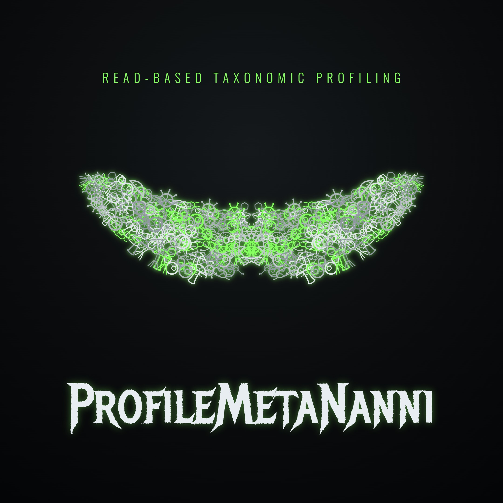
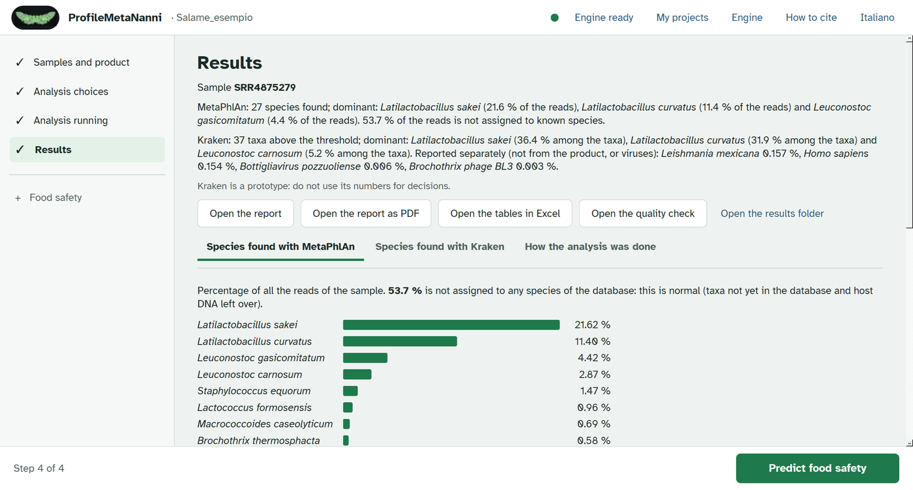
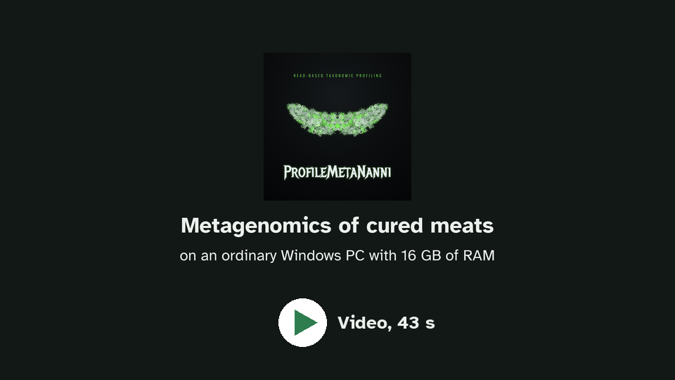
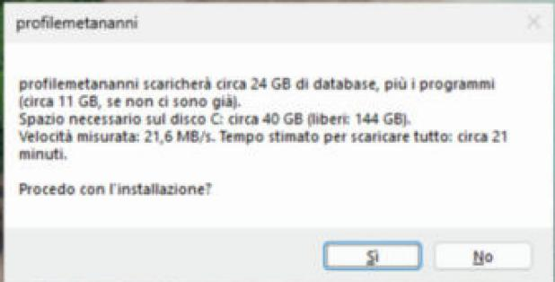
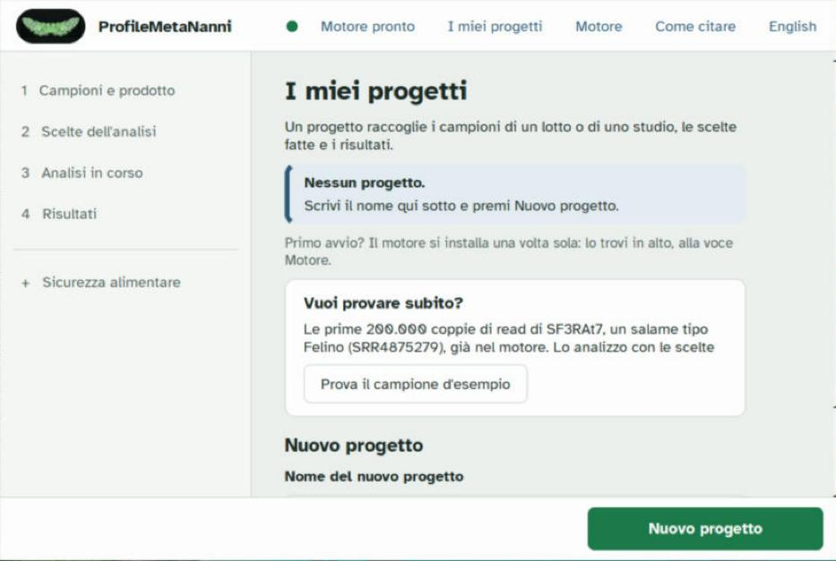
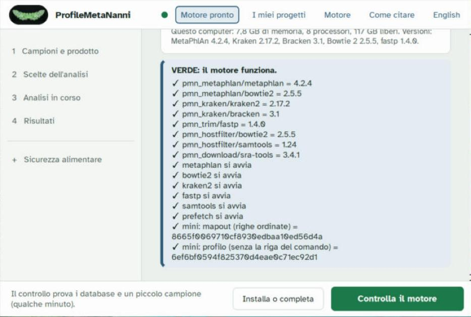
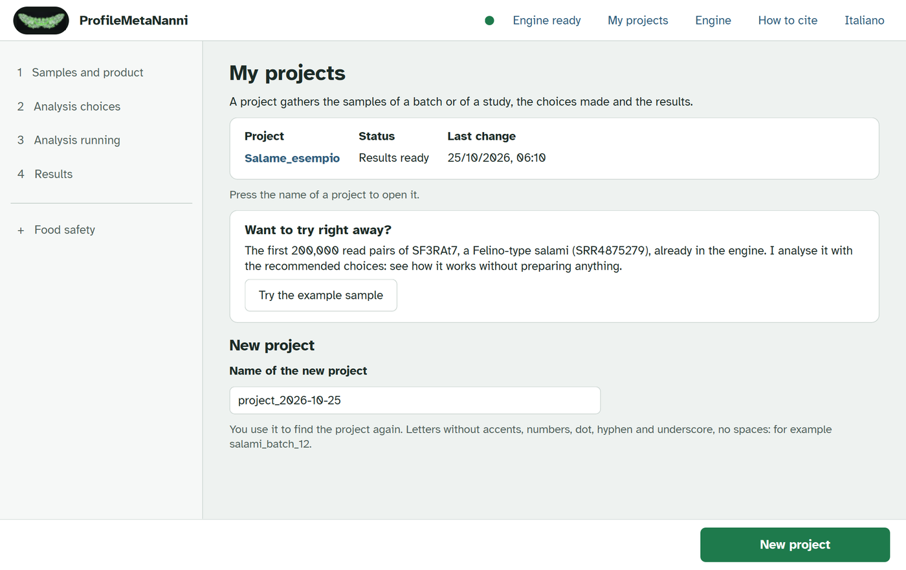
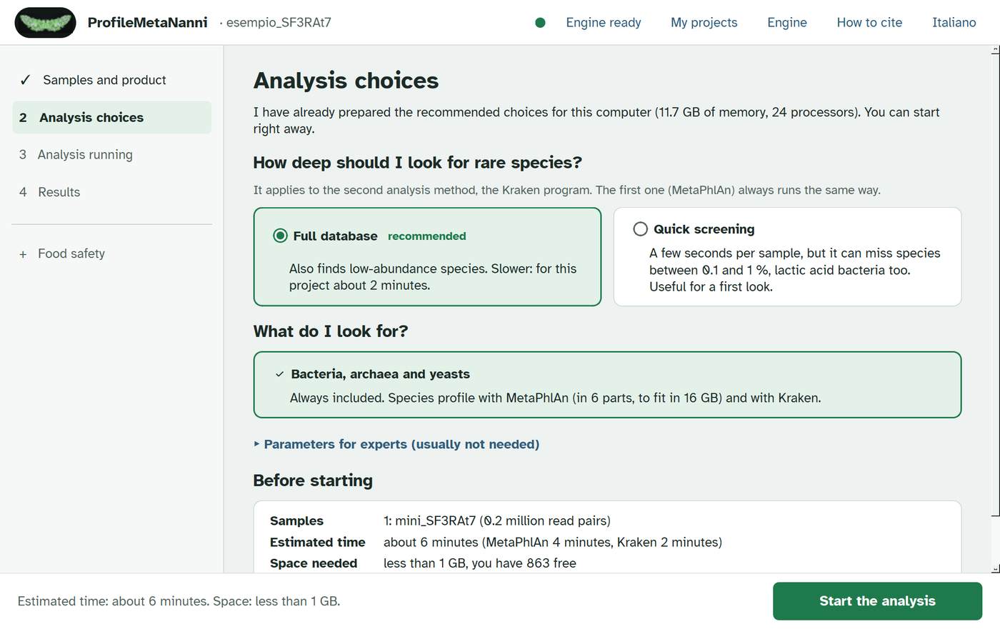
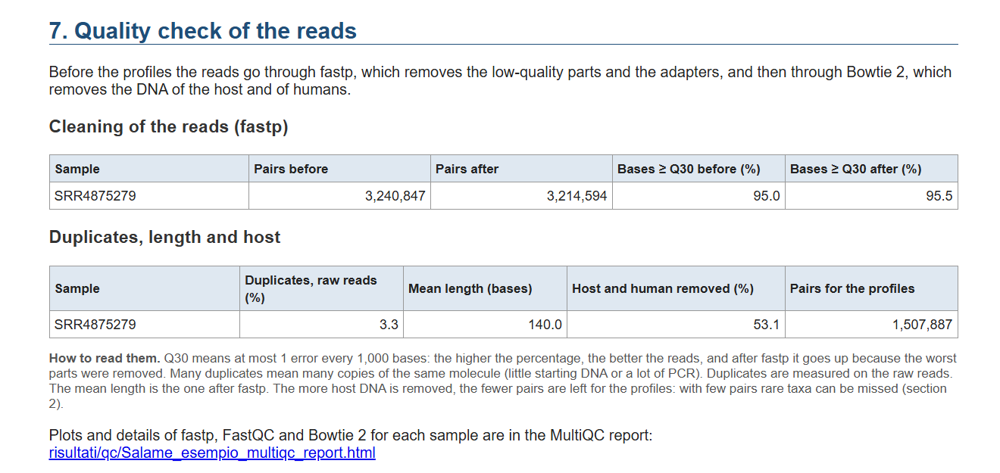
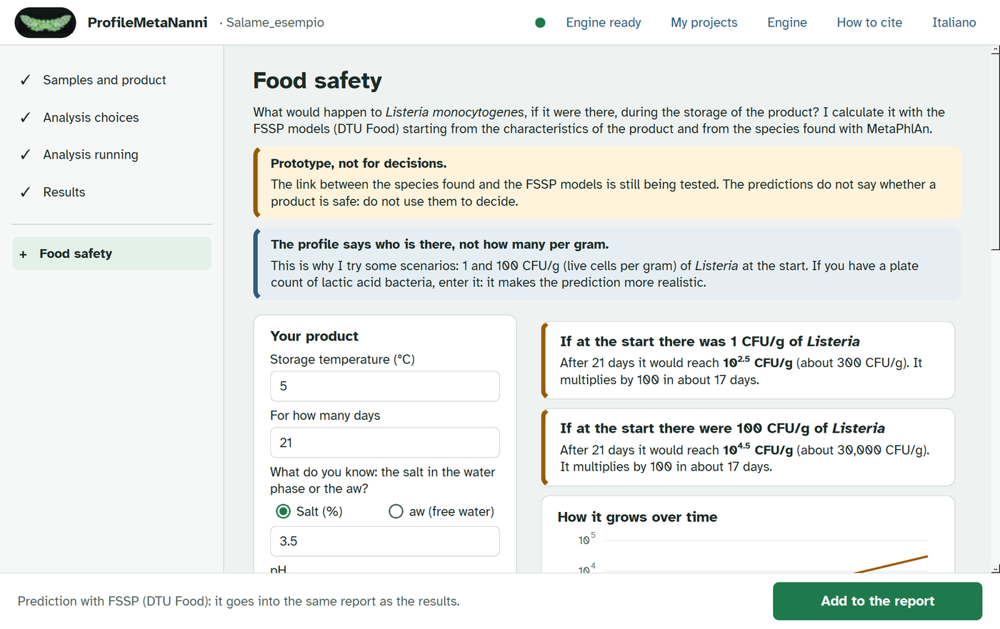

# ProfileMetaNanni 1.0

  

**English** | [Italiano](#italiano)

**Metagenomics of cured meat products on an ordinary Windows PC with 16 GB of RAM.** From the DNA sequencing reads of a sample to which taxa are present and in which proportion. It installs with a double click and works without a terminal.

> **Coming soon.** The installer is being published. To know when it is ready, follow this repository: **Star** or **Watch** at the top of the page.

  

   
  <i>A 43-second video of the program: click the picture to open it.</i>

## How to install

### Download: coming soon

The installer zip will be published here soon.

Before you start, check that you have:

- a PC with **Windows 11** and **16 GB of RAM**;
- about **300 GB free** on an internal disk (not a USB disk). Once installed, about 190 GB stay in use;
- an internet connection, better with a cable. About 139 GB of databases are downloaded: with a 100 Mbit/s network it takes more than 3 hours, with a 30 Mbit/s one more than 10 hours. Meanwhile you can use the PC.

Then 3 steps:

1. When it is published, download **profilemetananni_....zip** from the release linked here. Do not choose "Source code": that is the code, not the program to install.
2. Open the **Downloads** folder, right-click the zip and choose **Extract All**, then **Extract**.
3. In the extracted folder double-click **Installa profilemetananni**.

What you will see (in order) and how to answer. The installer speaks the language of Windows: Italian on an Italian Windows, English otherwise.

| Window | What to do |
|---|---|
| Windows security warning about the file (the program has no digital signature) | **Open** or **Run**. If "Windows protected your PC" appears: **More info**, then **Run anyway** |
| The installer needs a Windows component (WSL) | **OK**, then answer **Yes** to the Windows question |
| A restart is needed, restart now? | **Yes**. After the restart the installation starts again by itself |
| profilemetananni will download about ... GB of databases, with the space and the estimated time | read it and answer **Yes** |
| Progress bar | wait. The PC does not go to sleep by itself during the downloads |
| Everything is ready: profilemetananni is installed and works | **OK**: the program opens |

If WSL is already on the PC, the WSL and restart windows do not appear. If the network drops or you switch the PC off, double-click **Installa profilemetananni** again: it resumes from where it stopped and does not download again the files already checked.

   
  <i>The question before the download, on an Italian Windows (the numbers change from PC to PC: this picture comes from a reduced test).</i>

At the end you find **ProfileMetaNanni** on the desktop and in the Start menu. The green dot at the top, "Motore pronto" (engine ready), means you can work. The **Controlla il motore** (check the engine) button tests databases and programs on a small sample and answers VERDE (green).

  
  

Full guide, with how to use the program (Italian): [User guide (PDF)](docs/Manuale_uso_ProfileMetaNanni.pdf).

## Why it exists

ProfileMetaNanni has one goal: **to democratise metagenomics**. It brings it to research centres and agri-food companies that cannot afford a computing cluster or technical staff with programming skills to run these tools.

This is why it is a Windows program that installs with a double click and runs with windows, without a terminal. It works on an ordinary PC with 16 GB of RAM.

## What it does

It starts from shotgun sequencing reads of a cured meat product (`.fastq.gz` files from the sequencing lab, or SRR/ERR/DRR accessions from a public archive) and reports which taxa are present and in which proportion.

| Step | Tool |
|---|---|
| Read cleaning and quality control | fastp, FastQC, MultiQC |
| Host read removal | Bowtie 2 against pig (Sscrofa11.1), cattle (ARS-UCD1.2), sheep (ARS-UI_Ramb_v2.0) and human (GRCh38) |
| Marker-gene taxonomic profiling | MetaPhlAn 4.2.4 with the `mpa_vJan25_CHOCOPhlAnSGB_202503` database |
| k-mer taxonomic profiling (prototype) | Kraken 2 + Bracken with PlusPF (full) or PlusPF-8 (quick screening) |
| Alpha diversity at equal depth | richness, Shannon, Simpson, for each method |
| Food safety scenarios (prototype) | FSSP 4.0 predictive microbiology models for *Listeria monocytogenes* |
| Report | HTML, PDF and Excel, with versions, parameters, limits and citations |

MetaPhlAn and Kraken are always kept separate: their numbers are never summed or averaged. The abundance threshold applies to Kraken only (0.1 % with the full database); MetaPhlAn is never filtered.

### MetaPhlAn on 16 GB: the "sliced" index

Standard MetaPhlAn with vJan25 needs about 33 GB of RAM. ProfileMetaNanni splits the vJan25 Bowtie 2 index into 6 taxonomic slices, aligns the reads to one slice at a time and recomputes the Bowtie 2 MAPQ on the merged result; then the unchanged MetaPhlAn 4.2.4 reads the alignment with `--input_type mapout`. On a test sample the species profile is identical to the standard one (27 species out of 27) with a RAM peak of 8.2 GB.

## Screenshots

  
   
  <i>My projects, with the example sample ready. The choices of the analysis, with the estimated time.</i>

  
   
  <i>The report with the quality check of the reads. Food safety scenarios (prototype, not for decisions).</i>

## Requirements

| What | Value |
|---|---|
| System | Windows 11 (tested) |
| RAM | 16 GB |
| Disk | internal, about 300 GB free during installation (about 170-190 GB once installed) |
| Network | to download about 139 GB of databases (96.9 GB of public Kraken indexes + 41.8 GB of ProfileMetaNanni packages) |

The installer enables WSL2 (it asks once for administrator permission and one restart), creates a dedicated Linux space and installs the programs from lock files with pinned versions and the databases with MD5 checks.

## Status

Version 1.0, coming soon. Installation from scratch was tested on a clean Windows 11 virtual machine: 14 user interactions, no terminal, no help. The ProfileMetaNanni database packages (MetaPhlAn slices, host indexes, example sample) are downloaded from a release of this repository: the installer fetches them by itself and checks the MD5 of each one.

| Validation | Result |
|---|---|
| App versus command line, same sample | byte-identical |
| ZymoBIOMICS D6300 control community | MetaPhlAn 8 expected species out of 8, 0 extra species, Bray-Curtis 0.068 |
| Simulated cured-meat communities (12) | MetaPhlAn 0 false species in 12 out of 12; sensitivity criterion met in 4 out of 12, because rare taxa with few reads are lost (limit declared in the report) |
| Kraken calibration (confidence 0.5 + 0.1 % threshold) | F1 1.00 on the control community |
| FSSP models rewritten in Python | 382 cases out of 382 equal to the original program |

## Documents

- User guide (Italian): [`docs/Manuale_uso_ProfileMetaNanni.pdf`](docs/Manuale_uso_ProfileMetaNanni.pdf)
- App and engine contract: [`docs/contratto_motore.md`](docs/contratto_motore.md)
- Installer: [`installer/LEGGIMI.md`](installer/LEGGIMI.md)

## How to cite

If you use the results, cite the tools and databases you used: MetaPhlAn 4 (Blanco-Míguez et al. 2023, *Nat Biotechnol* 41:1633-1644), Kraken 2 (Wood et al. 2019, *Genome Biol*), Bracken (Lu et al. 2017, *PeerJ Comput Sci*), Bowtie 2 (Langmead and Salzberg 2012, *Nat Methods* 9:357-359), fastp (Chen et al. 2018, *Bioinformatics*), FSSP (Mejlholm and Dalgaard 2009, *J Food Prot* 72:2132-2143) and the host genomes. The full list with DOIs is in the "Come citare" page of the app and at the end of every report.

## Licence

MIT (see `LICENSE`).

---

[English](#profilemetananni-10) | **Italiano**

**La metagenomica dei salumi su un normale PC Windows con 16 GB di RAM.** Dalle read di sequenziamento del DNA di un campione a quali taxa ci sono e in che proporzione. Si installa con un doppio clic e si usa senza terminale.

> **A breve.** Il programma da installare è in pubblicazione. Per sapere quando è pronto, segui questo repository: **Star** o **Watch** in alto nella pagina.

   
  <i>Un video di 43 secondi sul programma (in inglese): fai clic sull'immagine per aprirlo.</i>

## Come si installa

### Download: a breve

Lo zip del programma da installare sarà pubblicato qui a breve.

Prima di iniziare controlla di avere:

- un PC con **Windows 11** e **16 GB di RAM**;
- circa **300 GB liberi** su un disco interno (non un disco USB). A installazione finita ne restano occupati circa 190;
- una connessione a internet, meglio col cavo. Si scaricano circa 139 GB di database: con una rete da 100 Mbit/s servono più di 3 ore, con una da 30 Mbit/s più di 10 ore. Intanto puoi usare il PC.

Poi 3 passi:

1. Quando sarà pubblicato, scarica **profilemetananni_....zip** dalla Release indicata qui. Non scegliere "Source code": quello è il codice, non il programma da installare.
2. Apri la cartella **Download**, fai clic destro sullo zip e scegli **Estrai tutto**, poi **Estrai**.
3. Nella cartella estratta fai doppio clic su **Installa profilemetananni**.

Che cosa vedrai (in ordine) e che cosa rispondere:

| Finestra | Che cosa fare |
|---|---|
| Avviso di sicurezza di Windows sul file (il programma non ha una firma digitale) | **Apri** o **Esegui**. Se compare "Windows ha protetto il PC": **Ulteriori informazioni**, poi **Esegui comunque** |
| "Per funzionare, profilemetananni ha bisogno di un componente di Windows (WSL)" | **OK**, poi alla domanda di Windows rispondi **Sì** |
| "Serve un riavvio del computer... Riavvio adesso?" | **Sì**. Dopo il riavvio l'installazione riparte da sola |
| "profilemetananni scaricherà circa ... GB di database", con lo spazio e il tempo stimato | leggi e rispondi **Sì** |
| Barra di avanzamento | aspetta. Il PC non va in sospensione da solo durante i download |
| "Tutto pronto: profilemetananni è installato e funziona" | **OK**: si apre il programma |

Se WSL c'è già sul PC, le finestre di WSL e del riavvio non compaiono. Se la rete cade o spegni il PC, fai di nuovo doppio clic su **Installa profilemetananni**: riprende da dove era arrivata e non riscarica i file già controllati.

   
  <i>La domanda prima del download (i numeri cambiano da PC a PC: questa foto viene da una prova ridotta).</i>

Alla fine trovi **ProfileMetaNanni** sul desktop e nel menu Start. Il pallino verde in alto, "Motore pronto", vuol dire che puoi lavorare. Il pulsante **Controlla il motore** prova database e programmi su un piccolo campione e risponde VERDE.

  
  

Guida completa, con l'uso del programma: [Manuale d'uso (PDF)](docs/Manuale_uso_ProfileMetaNanni.pdf).

## Perché esiste

ProfileMetaNanni ha un obiettivo: **democratizzare la metagenomica**. Vuole portarla nei centri di ricerca e nelle realtà produttive agroalimentari che non possono permettersi un cluster di calcolo né personale tecnico capace di programmare per far girare questi strumenti.

Per questo è un programma per Windows che si installa con un doppio clic e si usa con le finestre, senza terminale. Gira su un normale PC da 16 GB di RAM.

## Che cosa fa

Parte dalle read di sequenziamento shotgun di un salume (file `.fastq.gz` del laboratorio, oppure codici SRR/ERR/DRR di un archivio pubblico) e dice quali taxa ci sono e in che proporzione.

| Passo | Strumento |
|---|---|
| Pulizia e controllo qualità delle read | fastp, FastQC, MultiQC |
| Rimozione del DNA dell'ospite (host read removal) | Bowtie 2 su maiale (Sscrofa11.1), bovino (ARS-UCD1.2), pecora (ARS-UI_Ramb_v2.0) e uomo (GRCh38) |
| Profilo tassonomico con geni marcatori | MetaPhlAn 4.2.4 con il database `mpa_vJan25_CHOCOPhlAnSGB_202503` |
| Profilo tassonomico per k-mer (prototipo) | Kraken 2 + Bracken con PlusPF (completo) o PlusPF-8 (screening rapido) |
| Diversità alfa a profondità uguale | ricchezza, Shannon, Simpson, per ciascun metodo |
| Scenari di sicurezza alimentare (prototipo) | modelli di microbiologia predittiva di FSSP 4.0 per *Listeria monocytogenes* |
| Referto | HTML, PDF ed Excel, con versioni, parametri, limiti e citazioni |

MetaPhlAn e Kraken restano sempre separati: i loro numeri non si sommano e non si mediano. La soglia di abbondanza vale solo per Kraken (0,1 % col database completo); MetaPhlAn non viene mai filtrato.

### MetaPhlAn su 16 GB: l'indice "a fette"

MetaPhlAn standard con vJan25 chiede circa 33 GB di RAM. ProfileMetaNanni divide l'indice Bowtie 2 di vJan25 in 6 parti per tassonomia, allinea le read su una parte alla volta e ricalcola il MAPQ di Bowtie 2 sul risultato unito; poi MetaPhlAn 4.2.4, invariato, legge l'allineamento con `--input_type mapout`. Su un campione di prova il profilo di specie è identico a quello standard (27 specie su 27) con un picco di RAM di 8,2 GB.

## Schermate

  
   
  <i>I miei progetti, con il campione d'esempio pronto. Le scelte dell'analisi, con il tempo stimato (app in inglese; l'italiano è a un clic).</i>

  
   
  <i>Il referto con il controllo qualità delle read. Gli scenari di sicurezza alimentare (prototipo, non per decisioni).</i>

## Requisiti

| Cosa | Valore |
|---|---|
| Sistema | Windows 11 (provato) |
| RAM | 16 GB |
| Disco | interno, circa 300 GB liberi durante l'installazione (circa 170-190 GB a installazione finita) |
| Rete | per scaricare circa 139 GB di database (96,9 GB di indici Kraken pubblici + 41,8 GB di pacchetti ProfileMetaNanni) |

L'installatore attiva WSL2 (una volta chiede il permesso di amministratore e un riavvio), crea uno spazio Linux dedicato e ci installa i programmi da file di blocco con versioni fisse e i database con controllo MD5.

## Stato

Versione 1.0, a breve. L'installazione da zero è stata provata su Windows 11 pulito in una macchina virtuale: 14 interazioni dell'utente, nessun terminale, nessun aiuto. I pacchetti di database di ProfileMetaNanni (fette di MetaPhlAn, indici dell'ospite, campione d'esempio) si scaricano da una Release di questo repository: l'installatore li prende da solo e controlla l'MD5 di ognuno.

| Validazione | Risultato |
|---|---|
| App contro riga di comando, stesso campione | identici al byte |
| Comunità di controllo ZymoBIOMICS D6300 | MetaPhlAn 8 specie attese su 8, 0 specie in più, Bray-Curtis 0,068 |
| Comunità simulate di salume (12) | MetaPhlAn 0 specie false in 12 su 12; criterio di sensibilità superato in 4 su 12, perché i taxa rari con poche read si perdono (limite dichiarato nel referto) |
| Taratura di Kraken (confidence 0,5 + soglia 0,1 %) | F1 1,00 sulla comunità di controllo |
| Modelli FSSP riscritti in Python | 382 casi su 382 uguali al programma originale |

## Documenti

- Guida per l'utente: [`docs/Manuale_uso_ProfileMetaNanni.pdf`](docs/Manuale_uso_ProfileMetaNanni.pdf)
- Contratto fra app e motore: [`docs/contratto_motore.md`](docs/contratto_motore.md)
- Installatore: [`installer/LEGGIMI.md`](installer/LEGGIMI.md)

## Come citare

Se usi i risultati, cita gli strumenti e i database usati: MetaPhlAn 4 (Blanco-Míguez et al. 2023, *Nat Biotechnol* 41:1633-1644), Kraken 2 (Wood et al. 2019, *Genome Biol*), Bracken (Lu et al. 2017, *PeerJ Comput Sci*), Bowtie 2 (Langmead e Salzberg 2012, *Nat Methods* 9:357-359), fastp (Chen et al. 2018, *Bioinformatics*), FSSP (Mejlholm e Dalgaard 2009, *J Food Prot* 72:2132-2143) e i genomi dell'ospite. L'elenco completo, con i DOI, è nella pagina "Come citare" dell'app e in fondo a ogni referto.

## Licenza

MIT (vedi `LICENSE`).
