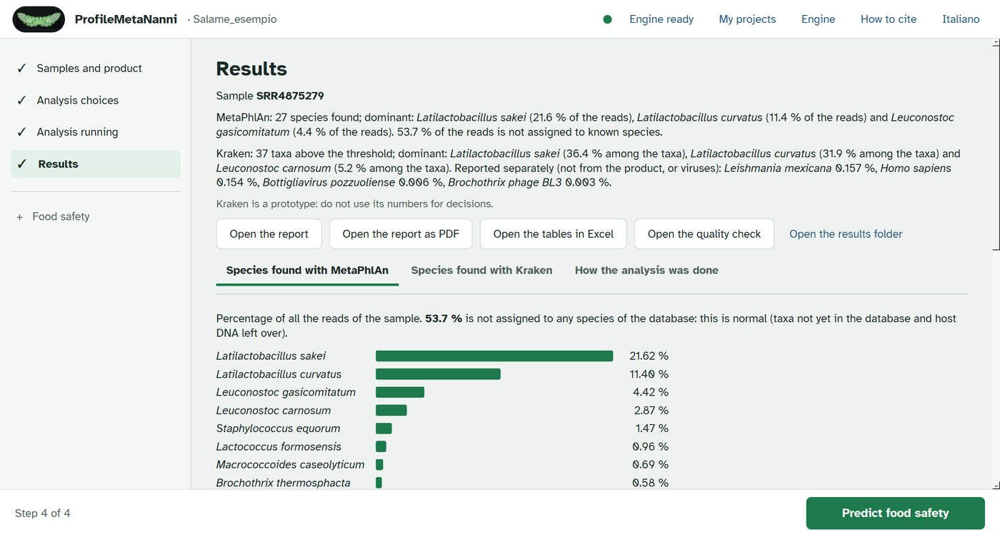
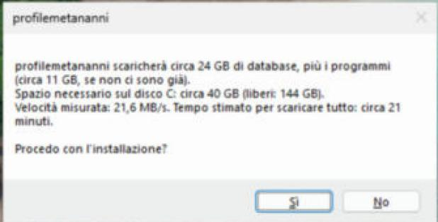
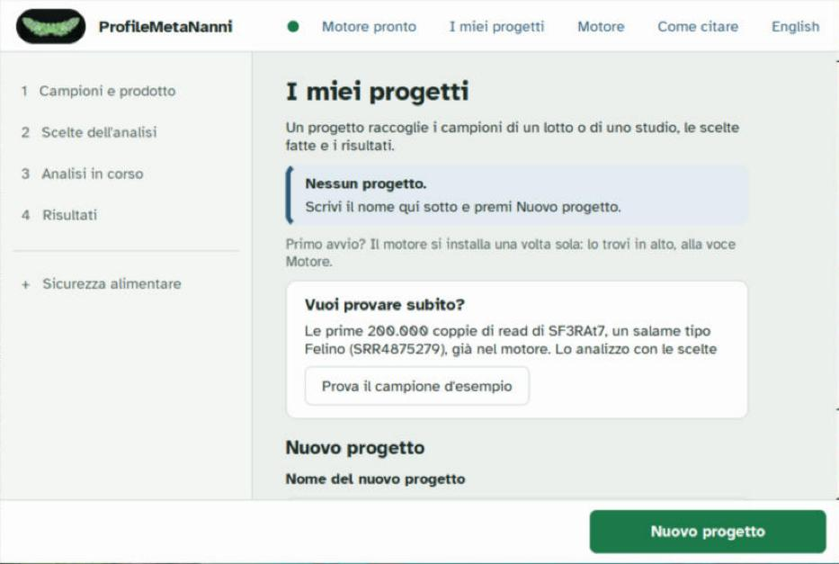
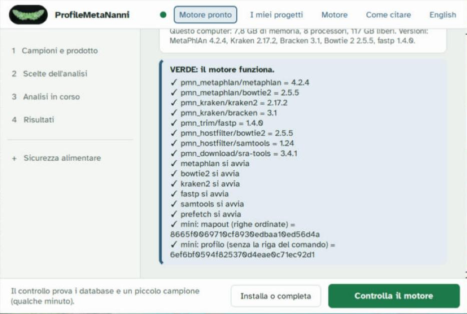
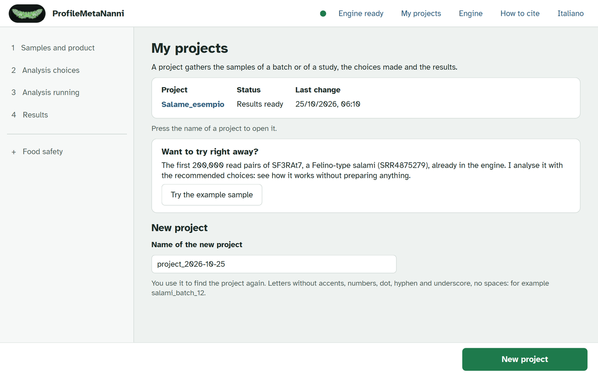
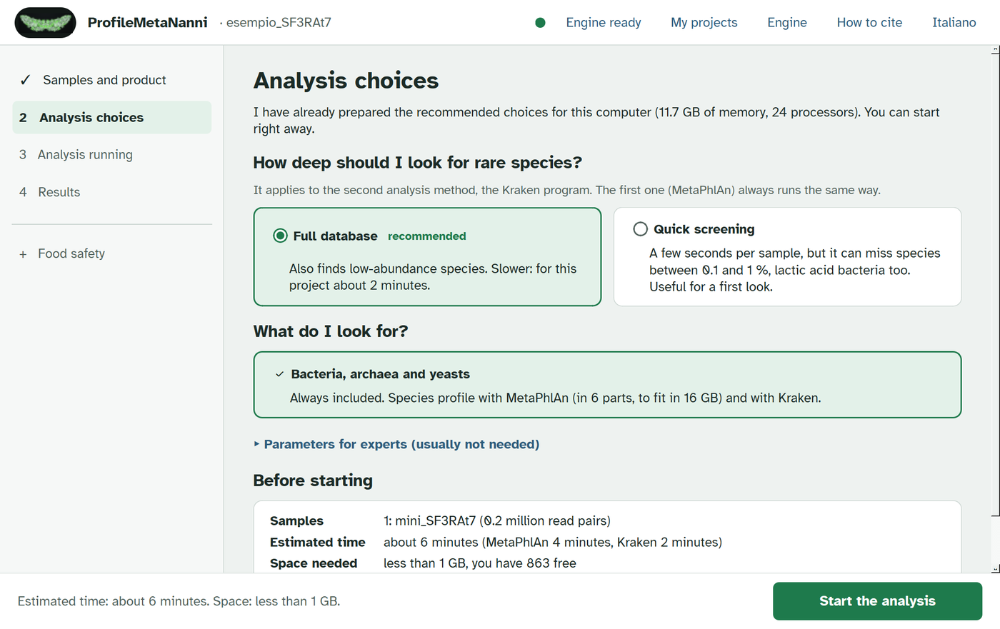
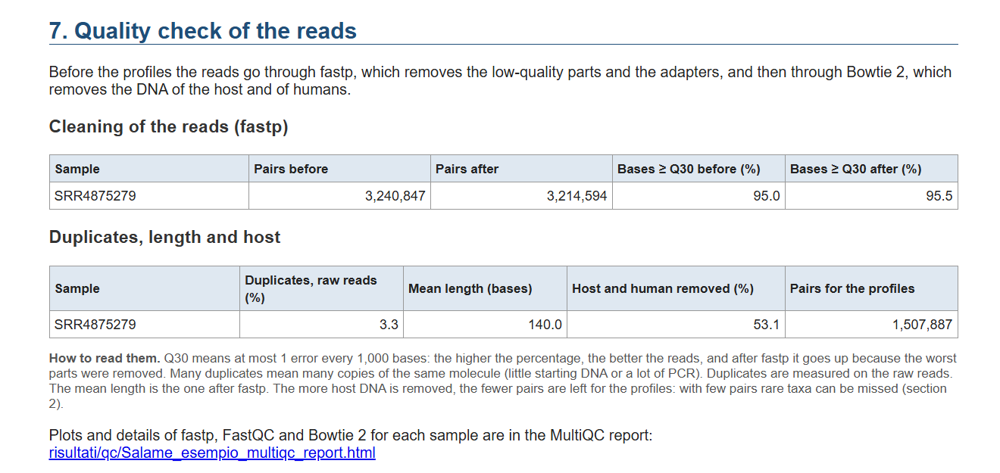
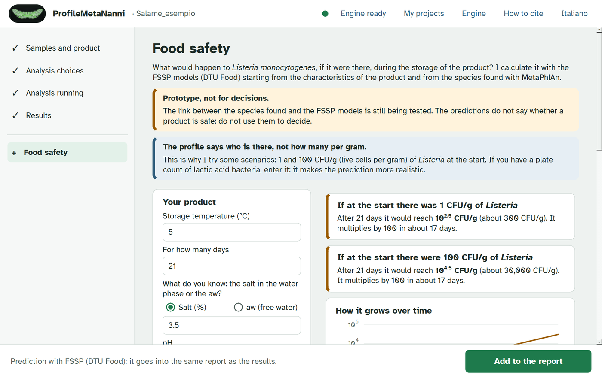

# ProfileMetaNanni 1.2

## [Download for Windows / Scarica per Windows](https://github.com/GiampieroFederici/profilemetananni/releases/download/v1.2.0/profilemetananni_v1.2.0.zip)

| English | Italiano |
|---|---|
| **1.** Click the link above: the zip (50 MB) goes to your **Downloads** folder. | **1.** Fai clic sul link qui sopra: lo zip (50 MB) va nella cartella **Download**. |
| **2.** Right-click the zip, choose **Extract All**, then **Extract**. | **2.** Clic destro sullo zip, scegli **Estrai tutto**, poi **Estrai**. |
| **3.** In the new folder, double-click **Installa profilemetananni** and answer the windows. | **3.** Nella cartella nuova, doppio clic su **Installa profilemetananni** e rispondi alle finestre. |

**You need** Windows 11 (not Mac), 16 GB of RAM, about 180 GB free on the internal disk, a few hours of download. Every window explained: [How to install](#how-to-install).

**First analysis:** [step-by-step guide on the example sample](docs/guida_analisi_esempio_EN.md) (also as [PDF](https://github.com/GiampieroFederici/profilemetananni/releases/download/v1.2.0/guida_analisi_esempio_EN.pdf)). The two example read files are in the [release](https://github.com/GiampieroFederici/profilemetananni/releases/tag/v1.2.0) too.

**Serve** Windows 11 (non Mac), 16 GB di RAM, circa 180 GB liberi sul disco interno, alcune ore di download. Ogni finestra spiegata: [Come si installa](#come-si-installa).

**Prima analisi:** [guida passo passo sul campione d'esempio](docs/guida_analisi_esempio_IT.md) (anche in [PDF](https://github.com/GiampieroFederici/profilemetananni/releases/download/v1.2.0/guida_analisi_esempio_IT.pdf)). I due file di read dell'esempio sono anche nella [Release](https://github.com/GiampieroFederici/profilemetananni/releases/tag/v1.2.0).

  

**English** | [Italiano](#italiano)

**Metagenomics of cured meat products on an ordinary Windows PC with 16 GB of RAM.** Since version 1.1 also human faeces, skin, soil and grapevine (experimental). From the DNA sequencing reads of a sample to which taxa are present and in which proportion. It installs with a double click and works without a terminal.

  

   
  <i>The program in 43 seconds. <a href="docs/vetrina/profilemetananni_video_en.mp4">Video MP4</a> (11 MB, to download).</i>

## How to install

### [Download ProfileMetaNanni for Windows (zip, 50 MB)](https://github.com/GiampieroFederici/profilemetananni/releases/download/v1.2.0/profilemetananni_v1.2.0.zip)

Before you start, check that you have:

- a PC with **Windows 11** and **16 GB of RAM**;
- about **180 GB free** on an internal disk (not a USB disk). Once installed, about 180 GB stay in use;
- an internet connection, better with a cable. About 139 GB of databases are downloaded, in pieces over several connections at once: with a 100 Mbit/s network it takes about 3 hours, with a 30 Mbit/s one about 10 hours. Meanwhile you can use the PC.

Then 3 steps:

1. Click the link above: the browser saves the zip in the **Downloads** folder.
2. Open the **Downloads** folder, right-click the zip and choose **Extract All**, then **Extract**.
3. In the extracted folder double-click **Installa profilemetananni**.

What you will see (in order) and how to answer. The installer speaks the language of Windows: Italian on an Italian Windows, English otherwise.

| Window | What to do |
|---|---|
| Windows security warning about the file (the program has no digital signature) | **Open** or **Run**. If "Windows protected your PC" appears: **More info**, then **Run anyway** |
| The installer needs a Windows component (WSL) | **OK**, then answer **Yes** to the Windows question |
| A restart is needed, restart now? | **Yes**. After the restart the installation starts again by itself, within about 2 minutes |
| profilemetananni will download about ... GB of databases, with the space and the estimated time | read it and answer **Yes** |
| Laptop lid question (only for long downloads) | keep the lid open, or answer **Yes** and the setting is put back at the end |
| Progress bar, with speed and time left | wait. The PC does not go to sleep by itself during the downloads. **Interrompi** (Stop) pauses the installation |
| Everything is ready: profilemetananni is installed and works | **OK**: the program opens |

If WSL is already on the PC, the WSL and restart windows do not appear. If the network drops, you press **Interrompi** or you switch the PC off, double-click **Installa profilemetananni** again: it resumes from where it stopped and does not download again the pieces already received. To update later, use the **Cerca aggiornamenti** (check for updates) button in the app: it asks before changing anything and keeps your projects.

   
  <i>The question before the download, on an Italian Windows (the numbers change from PC to PC: this picture comes from a reduced test).</i>

At the end you find **ProfileMetaNanni** on the desktop and in the Start menu. The green dot at the top, "Motore pronto" (engine ready), means you can work. The **Controlla il motore** (check the engine) button tests databases and programs on a small sample and answers VERDE (green).

  
  

Full guide, with how to use the program (Italian): [User guide (PDF)](docs/Manuale_uso_ProfileMetaNanni.pdf).

## Why it exists

ProfileMetaNanni has one goal: **to democratise metagenomics**. It brings it to research centres and agri-food companies that cannot afford a computing cluster or technical staff with programming skills to run these tools.

This is why it is a Windows program that installs with a double click and runs with windows, without a terminal. It works on an ordinary PC with 16 GB of RAM.

## What it does

It starts from shotgun sequencing reads (`.fastq.gz` files from the sequencing lab, or SRR/ERR/DRR accessions from a public archive) and reports which taxa are present and in which proportion. It was built and validated on cured meat products; human faeces, skin, soil and grapevine (must, berry, leaf, root) are available as **experimental** sample types, with their limits explained in the app and in [`docs/ambienti.md`](docs/ambienti.md).

| Step | Tool |
|---|---|
| Read cleaning and quality control | fastp, FastQC, MultiQC |
| Host read removal | Bowtie 2 (`--very-sensitive-local`; a read pair is removed if either read aligns, as in KneadData 0.12.5) against pig (Sscrofa11.1), cattle (ARS-UCD1.2), sheep (ARS-UI_Ramb_v2.0), grapevine (T2T-PN40024) and human (GRCh38), none, or a host you add from an NCBI assembly accession or a FASTA file |
| Marker-gene taxonomic profiling | MetaPhlAn 4.2.4 with the `mpa_vJan25_CHOCOPhlAnSGB_202503` database |
| k-mer taxonomic profiling (prototype) | Kraken 2 + Bracken with PlusPF (full) or PlusPF-8 (quick screening) |
| Alpha diversity at equal depth | richness, Shannon, Simpson, for each method |
| Several samples | alpha and beta diversity (Aitchison, Bray-Curtis), tests chosen from the study design, PERMANOVA always with the dispersion test; groups filled in a table in the app ([`docs/metadati.md`](docs/metadati.md)) |
| Food safety scenarios (prototype) | FSSP 4.0 predictive microbiology models for *Listeria monocytogenes* |
| Report | HTML, PDF and Excel, with versions, parameters, limits and citations |

MetaPhlAn and Kraken are always kept separate: their numbers are never summed or averaged. The abundance threshold applies to Kraken only (0.1 % with the full database); MetaPhlAn is never filtered.

### MetaPhlAn on 16 GB: the "sliced" index

Standard MetaPhlAn with vJan25 needs about 33 GB of RAM. ProfileMetaNanni splits the vJan25 Bowtie 2 index into 6 taxonomic slices, aligns the reads to one slice at a time and recomputes the Bowtie 2 MAPQ on the merged result; then the unchanged MetaPhlAn 4.2.4 reads the alignment with `--input_type mapout`. On a test sample the species profile is identical to the standard one (27 species out of 27) with a RAM peak of 8.2 GB.

## Screenshots

  
   
  <i>My projects, with the example sample ready. The choices of the analysis, with the estimated time.</i>

  
   
  <i>The report with the quality check of the reads. Food safety scenarios (prototype, not for decisions).</i>

## Requirements

| What | Value |
|---|---|
| System | Windows 11 (tested). Not available for macOS |
| RAM | 16 GB. An analysis uses at most about 5.4 GB inside WSL (measured on real cured-meat samples); the first analysis also builds the reduced MetaPhlAn database once, about 6.9 GB for one minute |
| Time | Measured with 24 processors: the example sample (0.2 million read pairs) 3-4 minutes; a cured-meat sample with 12.5 million read pairs about 38 minutes, most of it removing pig DNA (about 2.5 minutes per million pairs). With 8 processors the host step took 1.4 times longer, with 4 processors 2.4 times, with identical results. Samples with little host DNA spend most of the time in Kraken (ZymoBIOMICS standard, 8.8 million pairs: about 2.3 hours) |
| Disk | internal, about 180 GB free during installation (about 180 GB once installed). With much more free space the downloaded pieces are kept until they are checked, so an interruption never costs a new download |
| Network | to download about 139 GB of databases (96.9 GB of public Kraken indexes + 42.1 GB of ProfileMetaNanni packages) |

The installer enables WSL2 (it asks once for administrator permission and one restart), creates a dedicated Linux space and installs the programs from lock files with pinned versions and the databases with MD5 checks.

## Status

**In preparation: version 1.3 (branch `pmn-1.3-8gb-linux`, not released yet; the download above is 1.2).** Same results, byte for byte, with less memory and a faster Kraken step, and the program also runs on native Ubuntu ([guide](docs/guida_ubuntu_EN.md), with measured times). Measured on Ubuntu 24.04 with 4 processors and 8 GB: installation from scratch with the real download in 6 h 2 min, a whole salami sample (3.24 million read pairs) in 24 minutes with a 5.0 GB memory peak; the same sample still finishes with 4 GB of memory and 1 GB of swap. On Windows the installer now accepts a PC that shows at least 7.9 GB of memory: tested on a clean Windows 11 virtual machine with 8 GB (installation GREEN, whole sample in 59 minutes, identical outputs). 16 GB stays the recommended size: a real 8 GB PC with integrated graphics can show less than 7.9 GB, and that case is not tested.

Version 1.2. Host and human reads are removed as in KneadData 0.12.5 (Bowtie 2 `--very-sensitive-local`, a pair is removed if either read aligns), and MetaPhlAn computes the profile from a database reduced to the clades with reads: the profiles are byte-identical to a classic MetaPhlAn 4.2.4 run with the full database, and the memory peak of an analysis goes from 8.4 to 5.4 GB. Validated on simulated cured-meat communities with known truth (0.18 % of the true taxa read pairs removed by the host filter), on the ZymoBIOMICS D6300 standard (8 of 8 bacteria, no unexpected species above 0.1 % with MetaPhlAn or Kraken) and on real cured-meat samples compared with the previous version. Installation from scratch was tested on a clean Windows 11 virtual machine with the real downloads (Stop and resume, restart, the engine check GREEN, the example analysis); each correction found there was checked again on the same machine before this release. The full Kraken index does not fit on the test machine's disk, so on the virtual machine Kraken was run with the quick index; the full index was used on a real PC. Projects analysed with 1.1 redo cleaning, host removal, MetaPhlAn and Kraken by themselves, because the method changed.

| Validation | Result |
|---|---|
| App versus command line, same sample | byte-identical |
| ZymoBIOMICS D6300 control community | MetaPhlAn 8 expected species out of 8, 0 extra species, Bray-Curtis 0.068 |
| Simulated cured-meat communities (12) | MetaPhlAn 0 false species in 12 out of 12; sensitivity criterion met in 4 out of 12, because rare taxa with few reads are lost (limit declared in the report) |
| Kraken calibration (confidence 0.5 + 0.1 % threshold) | F1 1.00 on the control community |
| FSSP models rewritten in Python | 382 cases out of 382 equal to the original program |

## Documents

- First analysis, step by step, on the example sample: [`docs/guida_analisi_esempio_EN.md`](docs/guida_analisi_esempio_EN.md)
- User guide (Italian): [`docs/Manuale_uso_ProfileMetaNanni.pdf`](docs/Manuale_uso_ProfileMetaNanni.pdf)
- App and engine contract: [`docs/contratto_motore.md`](docs/contratto_motore.md)
- Installer: [`installer/LEGGIMI.md`](installer/LEGGIMI.md)

## How to cite

If you use the results, cite the tools and databases you used: MetaPhlAn 4 (Blanco-Míguez et al. 2023, *Nat Biotechnol* 41:1633-1644), Kraken 2 (Wood et al. 2019, *Genome Biol*), Bracken (Lu et al. 2017, *PeerJ Comput Sci*), Bowtie 2 (Langmead and Salzberg 2012, *Nat Methods* 9:357-359), fastp (Chen et al. 2018, *Bioinformatics*), FSSP (Mejlholm and Dalgaard 2009, *J Food Prot* 72:2132-2143) and the host genomes. The full list with DOIs is in the "Come citare" page of the app and at the end of every report.

The recommended Kraken settings come from the literature and from our calibration on simulated cured-meat communities and on the Zymo mock. The 0.1 % abundance threshold follows Portik, Brown and Pierce-Ward 2022 (*BMC Bioinformatics* 23:541): with Kraken 2, Bracken and PlusPF it cut the false species from hundreds to fewer than 15. They compute it on the total reads; ProfileMetaNanni computes it on the reads that Bracken assigns to a species. Confidence 0.5 is in line with Galanis et al. 2022 (*Mol Ecol Resour* 22:2506-2523). Lower thresholds, such as 0.001 %, are meant for very complex communities like soil (Edwin et al. 2024, *Environ Microbiome* 19:19).

## Licence

MIT (see `LICENSE`).

---

[English](#profilemetananni-11) | **Italiano**

**La metagenomica dei salumi su un normale PC Windows con 16 GB di RAM.** Dalla versione 1.1 anche feci umane, cute, suolo e vite (sperimentale). Dalle read di sequenziamento del DNA di un campione a quali taxa ci sono e in che proporzione. Si installa con un doppio clic e si usa senza terminale.

   
  <i>Il programma in 43 secondi (in inglese). <a href="docs/vetrina/profilemetananni_video_en.mp4">Video MP4</a> (11 MB, da scaricare).</i>

## Come si installa

### [Scarica ProfileMetaNanni per Windows (zip, 50 MB)](https://github.com/GiampieroFederici/profilemetananni/releases/download/v1.2.0/profilemetananni_v1.2.0.zip)

Prima di iniziare controlla di avere:

- un PC con **Windows 11** e **16 GB di RAM**;
- circa **180 GB liberi** su un disco interno (non un disco USB). A installazione finita ne restano occupati circa 180;
- una connessione a internet, meglio col cavo. Si scaricano circa 139 GB di database, a pezzi su più connessioni insieme: con una rete da 100 Mbit/s servono circa 3 ore, con una da 30 Mbit/s circa 10 ore. Intanto puoi usare il PC.

Poi 3 passi:

1. Fai clic sul link qui sopra: il browser salva lo zip nella cartella **Download**.
2. Apri la cartella **Download**, fai clic destro sullo zip e scegli **Estrai tutto**, poi **Estrai**.
3. Nella cartella estratta fai doppio clic su **Installa profilemetananni**.

Che cosa vedrai (in ordine) e che cosa rispondere:

| Finestra | Che cosa fare |
|---|---|
| Avviso di sicurezza di Windows sul file (il programma non ha una firma digitale) | **Apri** o **Esegui**. Se compare "Windows ha protetto il PC": **Ulteriori informazioni**, poi **Esegui comunque** |
| "Per funzionare, profilemetananni ha bisogno di un componente di Windows (WSL)" | **OK**, poi alla domanda di Windows rispondi **Sì** |
| "Serve un riavvio del computer... Riavvio adesso?" | **Sì**. Dopo il riavvio l'installazione riparte da sola, entro circa 2 minuti |
| "profilemetananni scaricherà circa ... GB di database", con lo spazio e il tempo stimato | leggi e rispondi **Sì** |
| Domanda sul coperchio del portatile (solo per scarichi lunghi) | tieni il coperchio aperto, oppure rispondi **Sì** e alla fine l'impostazione torna com'era |
| Barra di avanzamento, con velocità e tempo che manca | aspetta. Il PC non va in sospensione da solo durante i download. **Interrompi** mette in pausa l'installazione |
| "Tutto pronto: profilemetananni è installato e funziona" | **OK**: si apre il programma |

Se WSL c'è già sul PC, le finestre di WSL e del riavvio non compaiono. Se la rete cade, premi **Interrompi** o spegni il PC, fai di nuovo doppio clic su **Installa profilemetananni**: riprende da dove era arrivata e non riscarica i pezzi già arrivati. Per aggiornare in seguito c'è il pulsante **Cerca aggiornamenti** nell'app: chiede prima di cambiare qualcosa e conserva i tuoi progetti.

   
  <i>La domanda prima del download (i numeri cambiano da PC a PC: questa foto viene da una prova ridotta).</i>

Alla fine trovi **ProfileMetaNanni** sul desktop e nel menu Start. Il pallino verde in alto, "Motore pronto", vuol dire che puoi lavorare. Il pulsante **Controlla il motore** prova database e programmi su un piccolo campione e risponde VERDE.

  
  

Guida completa, con l'uso del programma: [Manuale d'uso (PDF)](docs/Manuale_uso_ProfileMetaNanni.pdf).

## Perché esiste

ProfileMetaNanni ha un obiettivo: **democratizzare la metagenomica**. Vuole portarla nei centri di ricerca e nelle realtà produttive agroalimentari che non possono permettersi un cluster di calcolo né personale tecnico capace di programmare per far girare questi strumenti.

Per questo è un programma per Windows che si installa con un doppio clic e si usa con le finestre, senza terminale. Gira su un normale PC da 16 GB di RAM.

## Che cosa fa

Parte dalle read di sequenziamento shotgun (file `.fastq.gz` del laboratorio, oppure codici SRR/ERR/DRR di un archivio pubblico) e dice quali taxa ci sono e in che proporzione. È stato costruito e validato sui salumi; feci umane, cute, suolo e vite (mosto, acino, foglia, radice) sono disponibili come tipi di campione **sperimentali**, con i limiti spiegati nell'app e in [`docs/ambienti.md`](docs/ambienti.md).

| Passo | Strumento |
|---|---|
| Pulizia e controllo qualità delle read | fastp, FastQC, MultiQC |
| Rimozione del DNA dell'ospite (host read removal) | Bowtie 2 (`--very-sensitive-local`; una coppia di read si toglie se anche una sola read si allinea, come in KneadData 0.12.5) su maiale (Sscrofa11.1), bovino (ARS-UCD1.2), pecora (ARS-UI_Ramb_v2.0), vite (T2T-PN40024) e uomo (GRCh38), nessuno, oppure un ospite che aggiungi tu con il codice di un assembly NCBI o un file FASTA |
| Profilo tassonomico con geni marcatori | MetaPhlAn 4.2.4 con il database `mpa_vJan25_CHOCOPhlAnSGB_202503` |
| Profilo tassonomico per k-mer (prototipo) | Kraken 2 + Bracken con PlusPF (completo) o PlusPF-8 (screening rapido) |
| Diversità alfa a profondità uguale | ricchezza, Shannon, Simpson, per ciascun metodo |
| Più campioni | diversità alfa e beta (Aitchison, Bray-Curtis), test scelti in base al disegno sperimentale, PERMANOVA sempre insieme al test della dispersione; gruppi compilati in una tabella nell'app ([`docs/metadati.md`](docs/metadati.md)) |
| Scenari di sicurezza alimentare (prototipo) | modelli di microbiologia predittiva di FSSP 4.0 per *Listeria monocytogenes* |
| Referto | HTML, PDF ed Excel, con versioni, parametri, limiti e citazioni |

MetaPhlAn e Kraken restano sempre separati: i loro numeri non si sommano e non si mediano. La soglia di abbondanza vale solo per Kraken (0,1 % col database completo); MetaPhlAn non viene mai filtrato.

### MetaPhlAn su 16 GB: l'indice "a fette"

MetaPhlAn standard con vJan25 chiede circa 33 GB di RAM. ProfileMetaNanni divide l'indice Bowtie 2 di vJan25 in 6 parti per tassonomia, allinea le read su una parte alla volta e ricalcola il MAPQ di Bowtie 2 sul risultato unito; poi MetaPhlAn 4.2.4, invariato, legge l'allineamento con `--input_type mapout`. Su un campione di prova il profilo di specie è identico a quello standard (27 specie su 27) con un picco di RAM di 8,2 GB.

## Schermate

  
   
  <i>I miei progetti, con il campione d'esempio pronto. Le scelte dell'analisi, con il tempo stimato (app in inglese; l'italiano è a un clic).</i>

  
   
  <i>Il referto con il controllo qualità delle read. Gli scenari di sicurezza alimentare (prototipo, non per decisioni).</i>

## Requisiti

| Cosa | Valore |
|---|---|
| Sistema | Windows 11 (provato). Non disponibile per macOS |
| RAM | 16 GB. Un'analisi usa al massimo circa 5,4 GB dentro la WSL (misurato su salumi veri); la prima analisi costruisce anche, una volta sola, il database ridotto di MetaPhlAn: circa 6,9 GB per un minuto |
| Tempo | Misurato con 24 processori: il campione d'esempio (0,2 milioni di coppie di read) 3-4 minuti; un salume con 12,5 milioni di coppie circa 38 minuti, quasi tutti per togliere il DNA del maiale (circa 2,5 minuti per milione di coppie). Con 8 processori quel passo ha richiesto 1,4 volte il tempo, con 4 processori 2,4 volte, con risultati identici. I campioni con poco DNA dell'ospite passano quasi tutto il tempo in Kraken (standard ZymoBIOMICS, 8,8 milioni di coppie: circa 2,3 ore) |
| Disco | interno, circa 180 GB liberi durante l'installazione (circa 180 GB a installazione finita). Con molto più spazio libero i pezzi scaricati restano fino al controllo, così un'interruzione non costa mai un nuovo scarico |
| Rete | per scaricare circa 139 GB di database (96,9 GB di indici Kraken pubblici + 42,1 GB di pacchetti ProfileMetaNanni) |

L'installatore attiva WSL2 (una volta chiede il permesso di amministratore e un riavvio), crea uno spazio Linux dedicato e ci installa i programmi da file di blocco con versioni fisse e i database con controllo MD5.

## Stato

**In preparazione: versione 1.3 (ramo `pmn-1.3-8gb-linux`, non ancora pubblicata; lo scarico qui sopra è la 1.2).** Stessi risultati, identici al byte, con meno memoria e un passo di Kraken più veloce, e il programma gira anche su Ubuntu nativo ([guida](docs/guida_ubuntu_IT.md), con i tempi misurati). Misurato su Ubuntu 24.04 con 4 processori e 8 GB: installazione da zero con lo scarico vero in 6 h 2 min, un salame intero (3,24 milioni di coppie di read) in 24 minuti con un picco di memoria di 5,0 GB; lo stesso campione finisce anche con 4 GB di memoria e 1 GB di swap. Su Windows l'installatore ora accetta un PC che mostra almeno 7,9 GB di memoria: provato su Windows 11 pulito in una macchina virtuale con 8 GB (installazione VERDE, campione intero in 59 minuti, uscite identiche). 16 GB restano la misura consigliata: un PC vero da 8 GB con la grafica integrata può mostrare meno di 7,9 GB, e quel caso non è provato.

Versione 1.2. Le read dell'ospite e dell'uomo si tolgono come in KneadData 0.12.5 (Bowtie 2 `--very-sensitive-local`, una coppia si toglie se anche una sola read si allinea), e MetaPhlAn calcola il profilo da un database ridotto ai clade che hanno read: i profili sono identici al byte a quelli di MetaPhlAn 4.2.4 classico con il database intero, e il picco di memoria di un'analisi scende da 8,4 a 5,4 GB. Validata su comunità simulate di salume a composizione nota (lo 0,18 % delle coppie di read dei taxa veri tolto dal filtro dell'ospite), sullo standard ZymoBIOMICS D6300 (8 batteri su 8, nessuna specie inattesa sopra lo 0,1 % con MetaPhlAn e con Kraken) e su campioni veri di salume confrontati con la versione precedente. L'installazione da zero è stata provata su Windows 11 pulito in una macchina virtuale con gli scarichi veri (Interrompi e ripresa, riavvio, controllo del motore VERDE, analisi d'esempio); ogni correzione trovata lì è stata riprovata sulla stessa macchina prima di questa Release. L'indice Kraken completo non sta sul disco della macchina di prova: lì Kraken ha usato l'indice rapido; l'indice completo è stato usato su un PC vero. I progetti analizzati con la 1.1 rifanno da soli pulizia, rimozione dell'ospite, MetaPhlAn e Kraken, perché il metodo è cambiato.

| Validazione | Risultato |
|---|---|
| App contro riga di comando, stesso campione | identici al byte |
| Comunità di controllo ZymoBIOMICS D6300 | MetaPhlAn 8 specie attese su 8, 0 specie in più, Bray-Curtis 0,068 |
| Comunità simulate di salume (12) | MetaPhlAn 0 specie false in 12 su 12; criterio di sensibilità superato in 4 su 12, perché i taxa rari con poche read si perdono (limite dichiarato nel referto) |
| Taratura di Kraken (confidence 0,5 + soglia 0,1 %) | F1 1,00 sulla comunità di controllo |
| Modelli FSSP riscritti in Python | 382 casi su 382 uguali al programma originale |

## Documenti

- Prima analisi, passo passo, sul campione d'esempio: [`docs/guida_analisi_esempio_IT.md`](docs/guida_analisi_esempio_IT.md)
- Guida per l'utente: [`docs/Manuale_uso_ProfileMetaNanni.pdf`](docs/Manuale_uso_ProfileMetaNanni.pdf)
- Contratto fra app e motore: [`docs/contratto_motore.md`](docs/contratto_motore.md)
- Installatore: [`installer/LEGGIMI.md`](installer/LEGGIMI.md)

## Come citare

Se usi i risultati, cita gli strumenti e i database usati: MetaPhlAn 4 (Blanco-Míguez et al. 2023, *Nat Biotechnol* 41:1633-1644), Kraken 2 (Wood et al. 2019, *Genome Biol*), Bracken (Lu et al. 2017, *PeerJ Comput Sci*), Bowtie 2 (Langmead e Salzberg 2012, *Nat Methods* 9:357-359), fastp (Chen et al. 2018, *Bioinformatics*), FSSP (Mejlholm e Dalgaard 2009, *J Food Prot* 72:2132-2143) e i genomi dell'ospite. L'elenco completo, con i DOI, è nella pagina "Come citare" dell'app e in fondo a ogni referto.

Le impostazioni consigliate di Kraken vengono dalla letteratura e dalla nostra taratura su comunità simulate di salume e sul campione Zymo. La soglia di abbondanza 0,1 % segue Portik, Brown e Pierce-Ward 2022 (*BMC Bioinformatics* 23:541): con Kraken 2, Bracken e PlusPF ha portato le specie false da centinaia a meno di 15. Loro la calcolano sulle read totali; ProfileMetaNanni sulle read che Bracken assegna a una specie. La confidence 0,5 è in accordo con Galanis et al. 2022 (*Mol Ecol Resour* 22:2506-2523). Soglie più basse, come 0,001 %, servono per comunità molto complesse come il suolo (Edwin et al. 2024, *Environ Microbiome* 19:19).

## Licenza

MIT (vedi `LICENSE`).
