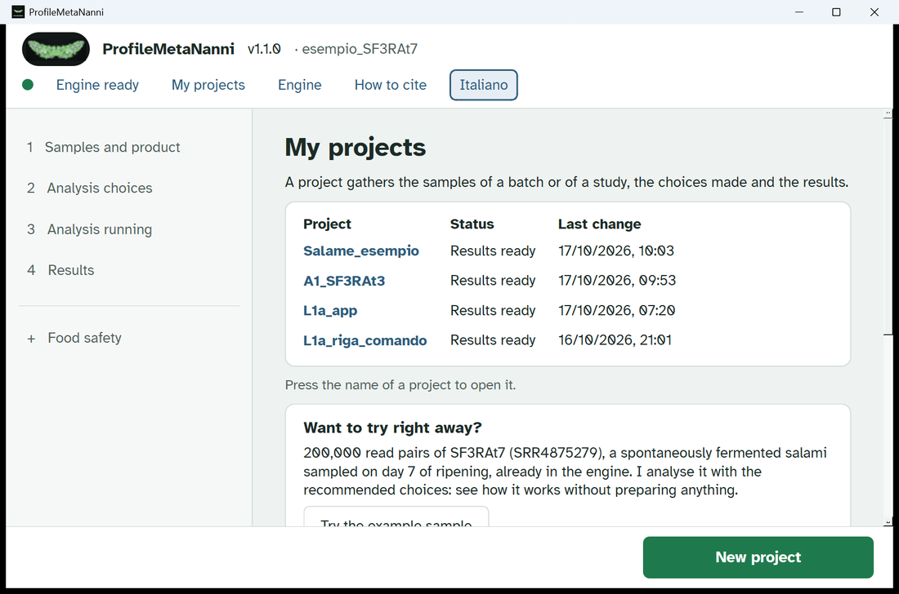
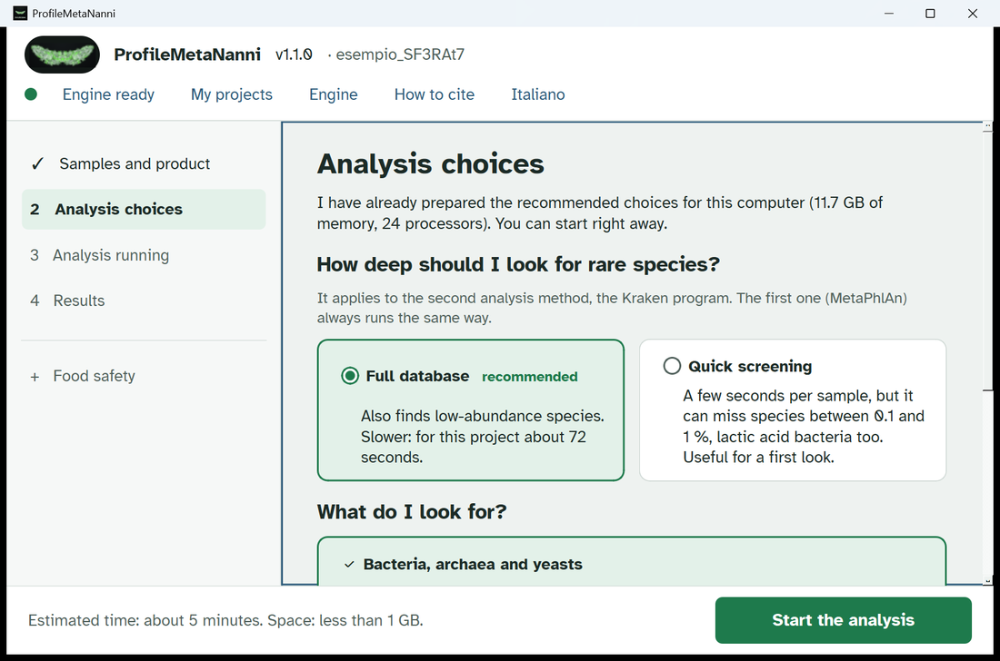
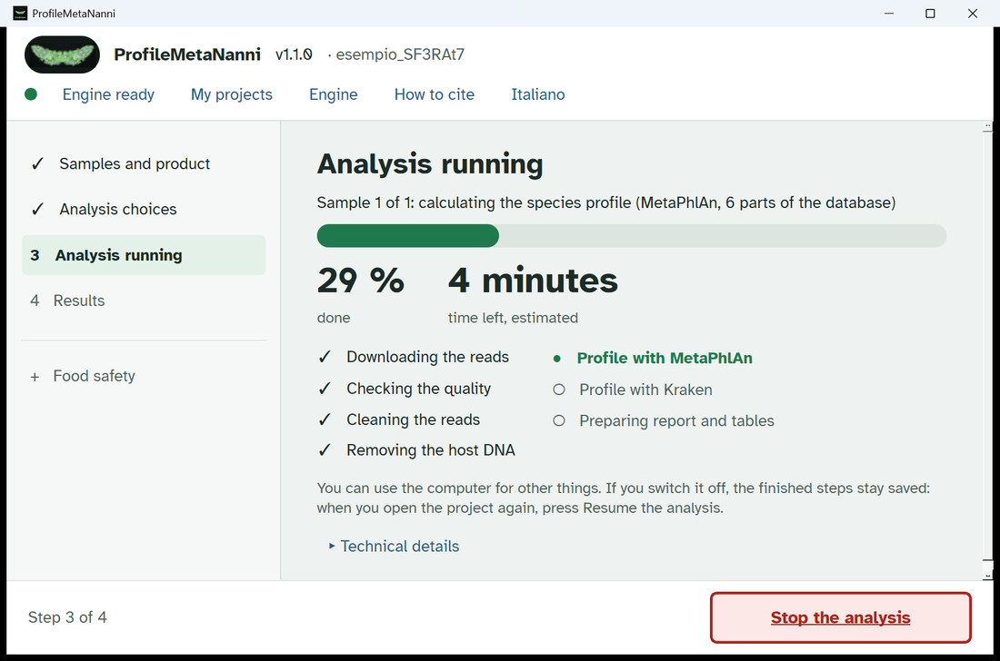
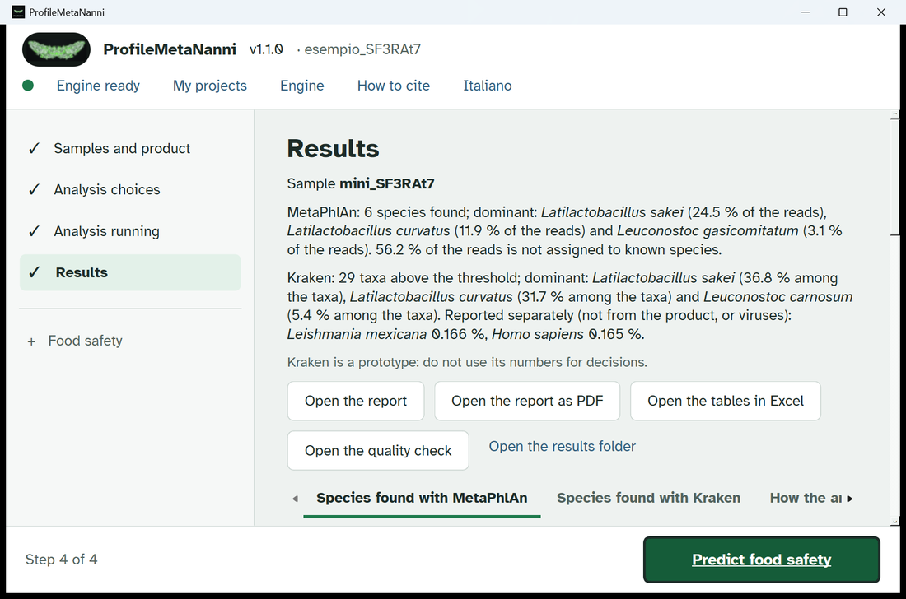
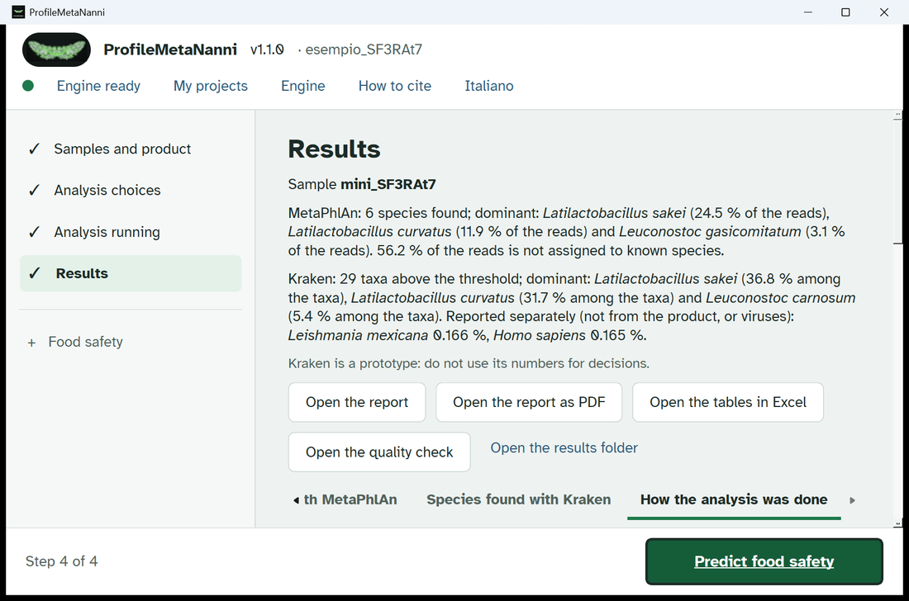
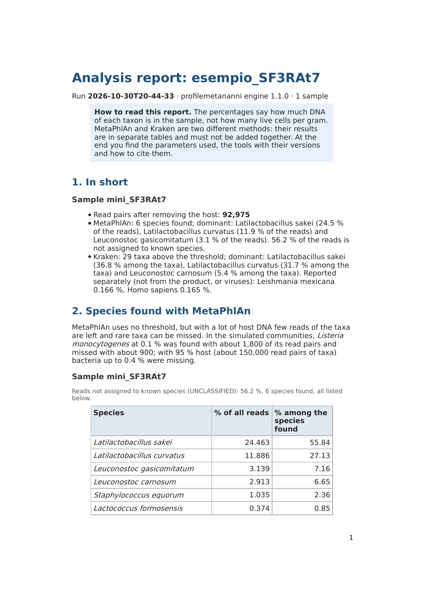

# Your first analysis with ProfileMetaNanni: the example sample

This guide walks through one complete analysis, from the home page to the report, on the example sample that comes with the program. Everything happens in the app: no terminal, no commands. The numbers and the pictures below come from a real run of ProfileMetaNanni 1.1 on a Windows PC (24 processors, 11.7 GB of memory for the engine). On your PC the times can be different; the results are the same.

Italian version: [guida_analisi_esempio_IT.md](guida_analisi_esempio_IT.md).

## 1. What you need

ProfileMetaNanni 1.1 must be installed (see [How to install](../README.md#how-to-install)) and the dot at the top of the window must be green, with **Engine ready** next to it. If it is grey or red, open the **Engine** page and press **Check the engine**.

## 2. The example sample

The example is 200,000 read pairs of the public sequencing run SRR4875279, already inside the program:

| | |
|---|---|
| Run | SRR4875279 (Illumina MiSeq, paired reads) |
| Study | BioProject PRJNA352236, SRA study SRP092525 |
| Sample | spontaneously fermented sausage, day 7 of ripening (archive sample S_7_A) |
| Article | Ferrocino et al. 2018, Appl Environ Microbiol 84(3):e02120-17, doi:10.1128/AEM.02120-17 |
| Files | `mini_SF3RAt7_1.fastq.gz` (MD5 `df87b76cb72c1abf2cf163fe6df27e9e`) and `mini_SF3RAt7_2.fastq.gz` (MD5 `1b005d394447fd15027d567f0a764eb2`), 200,000 reads each |

The whole run has 3,240,847 pairs. The example keeps 200,000 of them, so the analysis takes minutes instead of an hour. The two files are also attached to the [release](https://github.com/GiampieroFederici/profilemetananni/releases/tag/v1.1.0) (section 10).

## 3. Open the example

On the **My projects** page, in the box **Want to try right away?**, press **Try the example sample**. The program creates the project `esempio_SF3RAt7` with pig as the host. Then it takes you to the analysis choices.

## 4. Analysis choices and estimate

The recommended choices are already selected: **Full database** for Kraken and **Bacteria, archaea and yeasts**. You do not need to change anything. At the bottom of the page, **Before starting** shows what the engine expects for this PC:

- samples: 1, mini_SF3RAt7, 0.2 million read pairs;
- estimated time: about 5 minutes (MetaPhlAn 3 minutes, Kraken 72 seconds);
- space needed: less than 1 GB.

Press **Start the analysis**.

## 5. The analysis running

The page **Analysis running** shows the step, the percentage done and the time left. The steps are always the same: download or read the files, quality check, cleaning of the reads, removal of the host DNA, profile with MetaPhlAn, profile with Kraken, report and tables. You can use the PC for something else meanwhile. If you switch it off, the steps already finished are kept: open the project again and press **Resume the analysis**.

On the test PC the analysis took 4 minutes 44 seconds (Italian run) and 4 minutes 50 seconds (English run), against the estimate of about 5 minutes.

When it ends, press **See the results**.

## 6. Quality of the reads

Press **Open the quality check** on the Results page: the MultiQC report opens in the browser, with the graphs of fastp, FastQC and Bowtie 2. Section 6 of the report gives the same numbers in a table:

| | mini_SF3RAt7 |
|---|---|
| Read pairs before and after fastp | 200,000 and 200,000 |
| Bases with quality Q30 or higher | 95.3 % |
| Duplicates (raw reads) | 0.2 % |
| Mean read length after fastp | 140 bases |
| Pig and human DNA removed | 53.5 % |
| Read pairs left for the profiles | 92,975 |

Q30 means at most 1 error every 1,000 bases: 95.3 % is good. Few duplicates mean that the library was not over-amplified. More than half of the pairs are pig or human DNA: this is normal for a cured meat product. It is also the reason why only 92,975 pairs are left for the taxa.

## 7. Results

The top of the Results page gives one sentence for each method. MetaPhlAn and Kraken are two different methods: their numbers stay in separate tabs, they are never added together and they are not compared one to one.

### Species found with MetaPhlAn

MetaPhlAn looks for marker genes of each species. The percentages are of all the reads of the sample, without any threshold.

| Species | % of the reads |
|---|---|
| *Latilactobacillus sakei* | 24.46 |
| *Latilactobacillus curvatus* | 11.89 |
| *Leuconostoc gasicomitatum* | 3.14 |
| *Leuconostoc carnosum* | 2.91 |
| *Staphylococcus equorum* | 1.03 |
| *Lactococcus formosensis* | 0.37 |

56.2 % of the reads is not assigned to any species: they are host DNA left after the cleaning and taxa not yet in the database. This is normal and it is not an error.

### Species found with Kraken

Kraken is a **prototype**: its settings are calibrated on simulated communities and on a control community, not yet on real cured meat. Use its numbers as a comparison, not for decisions. Kraken compares every read with whole genomes; Bracken then estimates the abundances. Only bacteria, archaea and fungi with at least 0.1 % are shown (threshold of the full database), as a percentage among these taxa.

In this sample Kraken shows 29 taxa above the threshold (37 in total). The first ones are *Latilactobacillus sakei* 36.8 %, *Latilactobacillus curvatus* 31.7 %, *Leuconostoc carnosum* 5.4 %, *Leuconostoc gasicomitatum* 5.1 % and *Staphylococcus equorum* 3.3 %. Among the fungi there is the yeast *Debaryomyces hansenii*, 0.90 %. Two names are reported separately, outside the profile: *Leishmania mexicana* 0.166 % and *Homo sapiens* 0.165 %. They are mammal reads left after the cleaning, which the database assigns there because it does not contain the pig genome.

### How the analysis was done

The third tab lists the host DNA removed (pig Sscrofa11.1 and human GRCh38), the pairs left (92,975), the versions (MetaPhlAn 4.2.4 with database mpa_vJan25_CHOCOPhlAnSGB_202503 in 6 parts; Kraken 2.17.2 and Bracken 3.1 with database k2_pluspf_20260626) and the Kraken settings (confidence 0.5, at least 10 reads per species, threshold 0.1 %).

## 8. The report

**Open the report** shows it inside the app; **Open the report as PDF** and **Open the tables in Excel** open the files with the programs of Windows. The report has 9 sections: in brief, MetaPhlAn, Kraken, alpha diversity, viruses, quality of the reads, parameters, tools and databases with how to cite them, words used.

For this sample, alpha diversity (section 4) is:

| | Reads used | Taxa | Shannon | Simpson |
|---|---|---|---|---|
| MetaPhlAn | 183,241 | 6 species | 1.18 | 0.604 |
| Kraken + Bracken | 54,208 | 29 taxa | 1.96 | 0.753 |

If you use these results in a document, cite the tools and databases listed in section 8 of the report (also on the **How to cite** page).

## 9. What one sample of 200,000 pairs cannot tell

- **Absent is not the same as not found.** After the host removal 92,975 pairs are left. With so few reads, taxa below a few tenths of a percent can be missing. The report gives the measure (section 2): in simulated communities *Listeria monocytogenes* at 0.1 % was found with about 1,800 of its own read pairs and lost with about 900. The same sample analysed whole with ProfileMetaNanni (version 1.0, 1,507,887 pairs after the host) gives 27 species with MetaPhlAn instead of 6. With Kraken it gives 37 taxa instead of 29.
- **Percentages are DNA, not live cells.** They say how much DNA of each taxon is in the sample, not how many cells are alive. They are not colony-forming units per gram either.
- **One sample is not a comparison.** Without other samples and replicates there is no test between products, batches or times. Richness and Shannon depend on the number of reads: compare them only with samples at the same depth. For several samples use the multi-sample analysis of the program, with the groups written in the table of the Results page.
- **Kraken is a prototype** and the food safety prediction is a prototype too: do not use them for decisions. For *Listeria* a targeted analysis is needed.

## 10. Try it with the files

The example is already in the program. If you want to try the way you will use your own data:

1. Download `mini_SF3RAt7_1.fastq.gz` and `mini_SF3RAt7_2.fastq.gz` from the [release](https://github.com/GiampieroFederici/profilemetananni/releases/tag/v1.1.0) into one folder. Check the MD5 in section 2.
2. In **My projects** write a name and press **New project**.
3. In **Samples and product** choose **On my computer**, press **Choose the folder...** and select the folder with the two files; choose the product (Pork product).
4. Go on with **Analysis choices** and **Start the analysis**, as in sections 4 and 5.
