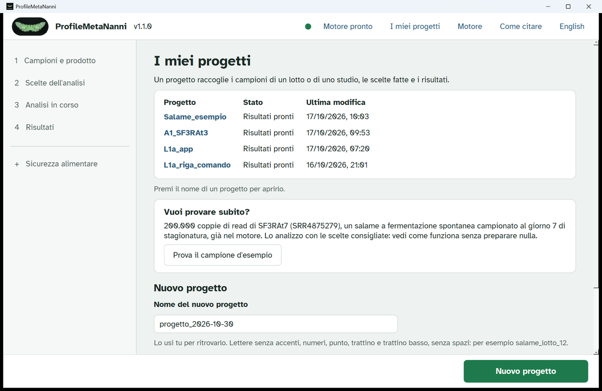
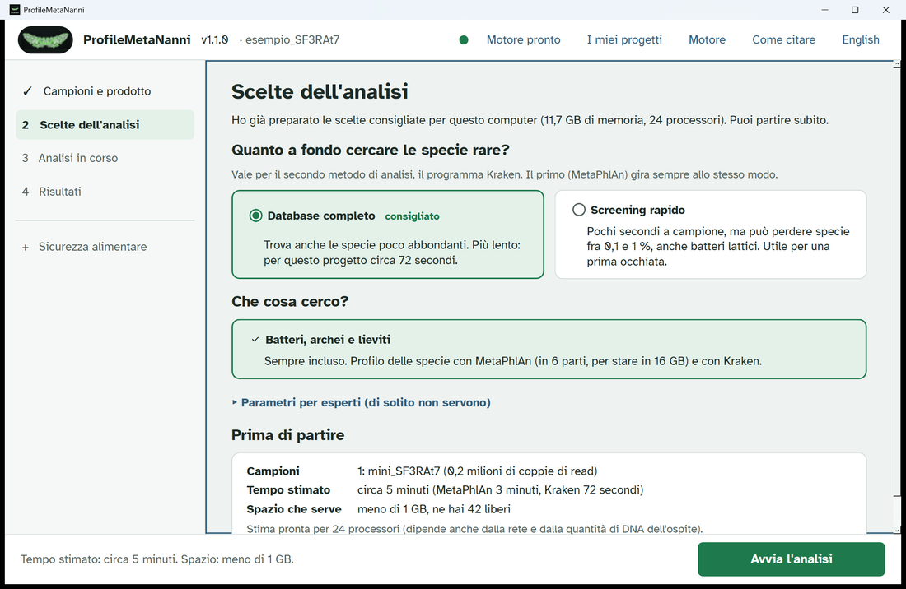
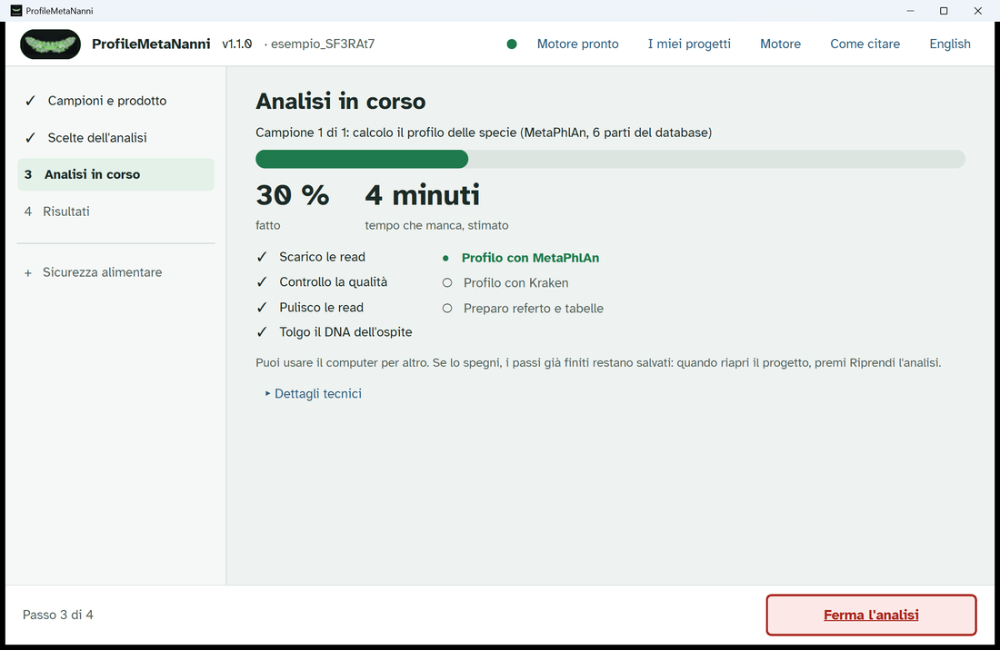
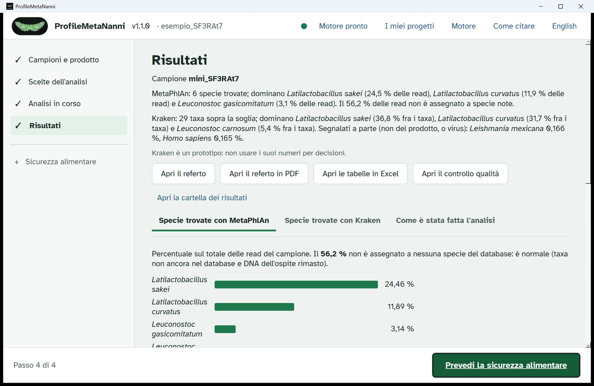
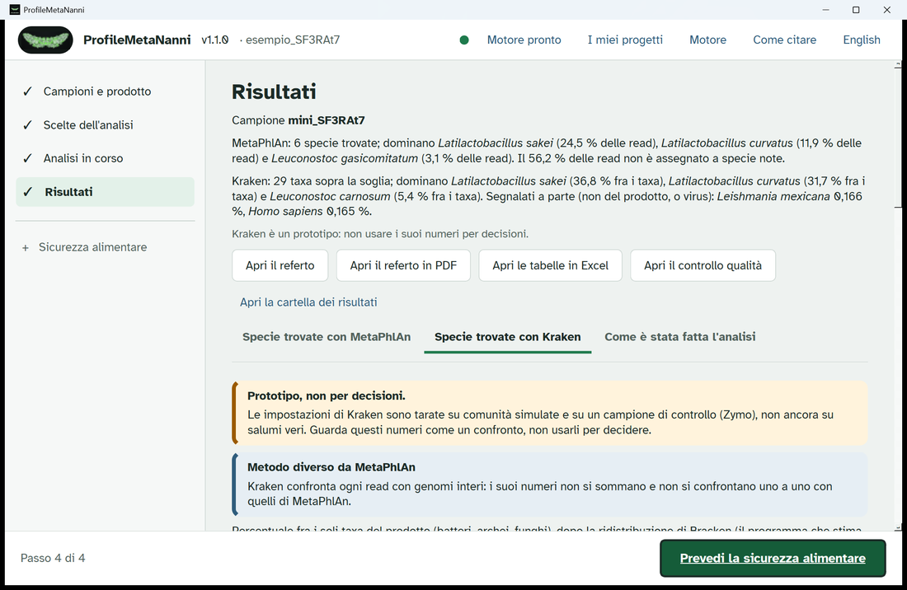
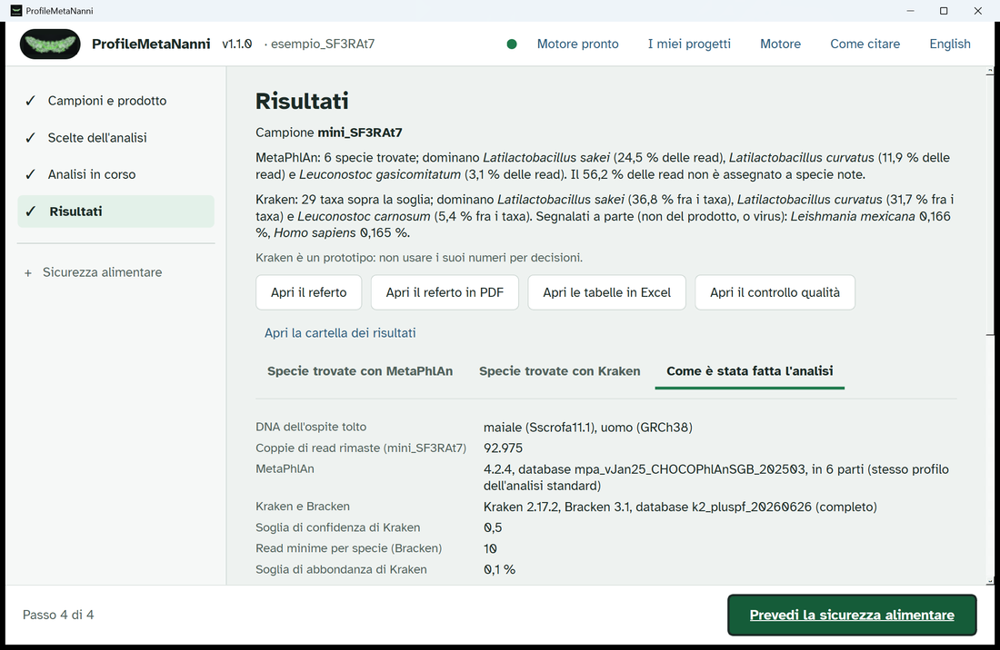
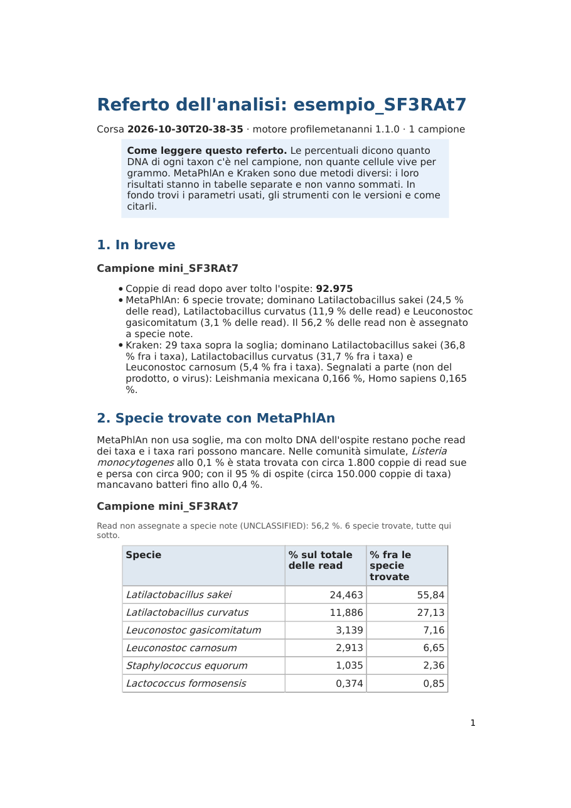

# La prima analisi con ProfileMetaNanni: il campione d'esempio

Questa guida accompagna un'analisi completa, dalla pagina iniziale al referto, sul campione d'esempio che arriva con il programma. Si fa tutto dall'app: niente terminale, niente comandi. I numeri e le immagini qui sotto vengono da una corsa vera di ProfileMetaNanni 1.1 su un PC Windows (24 processori, 11,7 GB di memoria per il motore). Sul tuo PC i tempi possono cambiare; i risultati sono gli stessi.

Versione inglese: [guida_analisi_esempio_EN.md](guida_analisi_esempio_EN.md).

## 1. Che cosa serve

ProfileMetaNanni 1.1 deve essere installato (vedi [Come si installa](../README.md#come-si-installa)) e il pallino in alto nella finestra deve essere verde, con accanto **Motore pronto**. Se è grigio o rosso, apri la pagina **Motore** e premi **Controlla il motore**.

## 2. Il campione d'esempio

L'esempio è fatto di 200.000 coppie di read della corsa di sequenziamento pubblica SRR4875279, già dentro il programma:

| | |
|---|---|
| Corsa | SRR4875279 (Illumina MiSeq, read a coppie) |
| Studio | BioProject PRJNA352236, studio SRA SRP092525 |
| Campione | salame a fermentazione spontanea, giorno 7 di stagionatura (campione S_7_A dell'archivio) |
| Articolo | Ferrocino et al. 2018, Appl Environ Microbiol 84(3):e02120-17, doi:10.1128/AEM.02120-17 |
| File | `mini_SF3RAt7_1.fastq.gz` (MD5 `df87b76cb72c1abf2cf163fe6df27e9e`) e `mini_SF3RAt7_2.fastq.gz` (MD5 `1b005d394447fd15027d567f0a764eb2`), 200.000 read ciascuno |

La corsa intera ha 3.240.847 coppie. L'esempio ne tiene 200.000: così l'analisi dura minuti invece di un'ora. I due file sono anche allegati alla [Release](https://github.com/GiampieroFederici/profilemetananni/releases/tag/v1.1.0) (sezione 10).

## 3. Apri l'esempio

Nella pagina **I miei progetti**, nel riquadro **Vuoi provare subito?**, premi **Prova il campione d'esempio**. Il programma crea il progetto `esempio_SF3RAt7` con il maiale come ospite. Poi ti porta alle scelte dell'analisi.

## 4. Scelte dell'analisi e stima

Le scelte consigliate sono già pronte: **Database completo** per Kraken e **Batteri, archei e lieviti**. Non serve cambiare nulla. In fondo alla pagina, **Prima di partire** dice che cosa si aspetta il motore su questo PC:

- campioni: 1, mini_SF3RAt7, 0,2 milioni di coppie di read;
- tempo stimato: circa 5 minuti (MetaPhlAn 3 minuti, Kraken 72 secondi);
- spazio che serve: meno di 1 GB.

Premi **Avvia l'analisi**.

## 5. L'analisi in corso

La pagina **Analisi in corso** mostra il passo, la percentuale fatta e il tempo che manca. I passi sono sempre gli stessi: scarico o lettura dei file, controllo della qualità, pulizia delle read, rimozione del DNA dell'ospite, profilo con MetaPhlAn, profilo con Kraken, referto e tabelle. Intanto puoi usare il PC per altro. Se lo spegni, i passi già finiti restano salvati: riapri il progetto e premi **Riprendi l'analisi**.

Sul PC di prova l'analisi è durata 4 minuti e 44 secondi (corsa in italiano) e 4 minuti e 50 secondi (corsa in inglese), contro una stima di circa 5 minuti.

Alla fine premi **Vedi i risultati**.

## 6. Qualità delle read

Nella pagina Risultati premi **Apri il controllo qualità**: si apre nel browser il report MultiQC, con i grafici di fastp, FastQC e Bowtie 2. La sezione 6 del referto dà gli stessi numeri in una tabella:

| | mini_SF3RAt7 |
|---|---|
| Coppie di read prima e dopo fastp | 200.000 e 200.000 |
| Basi con qualità Q30 o più | 95,3 % |
| Duplicati (read grezze) | 0,2 % |
| Lunghezza media delle read dopo fastp | 140 basi |
| DNA di maiale e uomo tolto | 53,5 % |
| Coppie di read rimaste per i profili | 92.975 |

Q30 vuol dire al massimo 1 errore ogni 1.000 basi: 95,3 % è un buon valore. Pochi duplicati vogliono dire che la libreria non è stata amplificata troppo. Più di metà delle coppie è DNA di maiale o dell'uomo: per un salume è normale. È anche il motivo per cui per i taxa restano solo 92.975 coppie.

## 7. Risultati

In cima alla pagina Risultati c'è una frase per ogni metodo. MetaPhlAn e Kraken sono due metodi diversi: i loro numeri stanno in schede separate, non si sommano mai e non si confrontano uno a uno.

### Specie trovate con MetaPhlAn

MetaPhlAn cerca i geni marcatori di ogni specie. Le percentuali sono sul totale delle read del campione, senza nessuna soglia.

| Specie | % delle read |
|---|---|
| *Latilactobacillus sakei* | 24,46 |
| *Latilactobacillus curvatus* | 11,89 |
| *Leuconostoc gasicomitatum* | 3,14 |
| *Leuconostoc carnosum* | 2,91 |
| *Staphylococcus equorum* | 1,03 |
| *Lactococcus formosensis* | 0,37 |

Il 56,2 % delle read non è assegnato a nessuna specie: è DNA dell'ospite rimasto dopo la pulizia, oppure di taxa non ancora nel database. È normale e non è un errore.

### Specie trovate con Kraken

Kraken è un **prototipo**: le sue impostazioni sono tarate su comunità simulate e su una comunità di controllo, non ancora su salumi veri. Usa i suoi numeri come confronto, non per decidere. Kraken confronta ogni read con genomi interi; poi Bracken stima le abbondanze. Si mostrano solo batteri, archei e funghi con almeno lo 0,1 % (soglia del database completo), come percentuale fra questi taxa.

In questo campione Kraken mostra 29 taxa sopra la soglia (37 in tutto). I primi sono *Latilactobacillus sakei* 36,8 %, *Latilactobacillus curvatus* 31,7 %, *Leuconostoc carnosum* 5,4 %, *Leuconostoc gasicomitatum* 5,1 % e *Staphylococcus equorum* 3,3 %. Fra i funghi c'è il lievito *Debaryomyces hansenii*, 0,90 %. Due nomi sono segnalati a parte, fuori dal profilo: *Leishmania mexicana* 0,166 % e *Homo sapiens* 0,165 %. Sono read di mammifero rimaste dopo la pulizia, che il database assegna lì perché non contiene il genoma del maiale.

### Come è stata fatta l'analisi

La terza scheda elenca il DNA dell'ospite tolto (maiale Sscrofa11.1 e uomo GRCh38), le coppie rimaste (92.975), le versioni (MetaPhlAn 4.2.4 con il database mpa_vJan25_CHOCOPhlAnSGB_202503 in 6 parti; Kraken 2.17.2 e Bracken 3.1 con il database k2_pluspf_20260626) e le impostazioni di Kraken (confidence 0,5, almeno 10 read per specie, soglia 0,1 %).

## 8. Il referto

**Apri il referto** lo mostra dentro l'app; **Apri il referto in PDF** e **Apri le tabelle in Excel** aprono i file con i programmi di Windows. Il referto ha 9 sezioni: in breve, MetaPhlAn, Kraken, diversità alfa, virus, qualità delle read, parametri, strumenti e database con il modo di citarli, parole usate.

Per questo campione la diversità alfa (sezione 4) è:

| | Read usate | Taxa | Shannon | Simpson |
|---|---|---|---|---|
| MetaPhlAn | 183.241 | 6 specie | 1,18 | 0,604 |
| Kraken + Bracken | 54.208 | 29 taxa | 1,96 | 0,753 |

Se usi questi risultati in un documento, cita gli strumenti e i database della sezione 8 del referto (anche nella pagina **Come citare**).

## 9. Che cosa non si può concludere da un campione di 200.000 coppie

- **Non trovato non vuol dire assente.** Dopo la rimozione dell'ospite restano 92.975 coppie. Con così poche read i taxa sotto pochi decimi di punto percentuale possono mancare. Il referto dà la misura (sezione 2): nelle comunità simulate *Listeria monocytogenes* allo 0,1 % è stata trovata con circa 1.800 coppie di read sue e persa con circa 900. Lo stesso campione analizzato intero con ProfileMetaNanni (versione 1.0, 1.507.887 coppie dopo l'ospite) dà 27 specie con MetaPhlAn invece di 6. Con Kraken dà 37 taxa invece di 29.
- **Le percentuali sono DNA, non cellule vive.** Dicono quanto DNA di ogni taxon c'è nel campione, non quante cellule sono vive. Non sono nemmeno unità formanti colonia per grammo.
- **Un campione non è un confronto.** Senza altri campioni e repliche non c'è nessun test fra prodotti, lotti o tempi. Ricchezza e Shannon dipendono dal numero di read: confrontale solo con campioni alla stessa profondità. Per più campioni usa l'analisi multicampione del programma, con i gruppi scritti nella tabella della pagina Risultati.
- **Kraken è un prototipo** e anche la previsione della sicurezza alimentare è un prototipo: non usarli per decidere. Per *Listeria* serve un'analisi mirata.

## 10. Provalo con i file

L'esempio è già nel programma. Se vuoi provare il modo in cui userai i tuoi dati:

1. Scarica `mini_SF3RAt7_1.fastq.gz` e `mini_SF3RAt7_2.fastq.gz` dalla [Release](https://github.com/GiampieroFederici/profilemetananni/releases/tag/v1.1.0) in una stessa cartella. Controlla l'MD5 della sezione 2.
2. In **I miei progetti** scrivi un nome e premi **Nuovo progetto**.
3. In **Campioni e prodotto** scegli **Sul mio computer**, premi **Scegli la cartella...** e seleziona la cartella con i due file; scegli il prodotto (salume di maiale).
4. Vai avanti con **Scelte dell'analisi** e **Avvia l'analisi**, come nelle sezioni 4 e 5.
